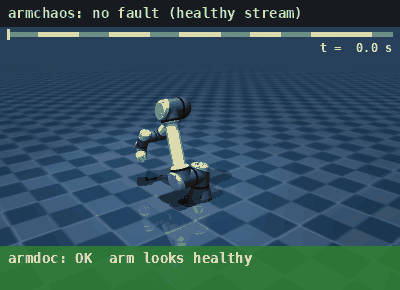

# armchaos

[](https://github.com/darshmenon/armchaos/actions/workflows/ci.yml) [](https://github.com/darshmenon/armchaos/releases) [](LICENSE) 

**Does your arm stack notice when something breaks?** Break a ros2_control arm on purpose (frozen, late, noisy, NaN or spoofed joint states, a deactivated controller), then restore it. Pair it with [armdoc](https://github.com/darshmenon/armdoc) to check the doctor names each fault.



*A real UR5e model (MuJoCo Menagerie) moves through a loop. The five faults reshape the joint-state stream with the real armchaos fault models; the arm drawn is the arm as the stack sees it, and the bar underneath is what the real armdoc checks say. Simulated time, no ROS: `PYTHONPATH=.:../armdoc python3 examples/make_demo_gif.py`. A model, not a real robot.*

## Quick start

```bash
# install (ROS 2 Humble sourced; use --system-site-packages if you use a venv)
pip install git+https://github.com/darshmenon/armchaos       # or: colcon build --packages-select armchaos

armchaos list                                    # the faults and their parameters
armchaos inject freeze --for 8 --dry-run         # show the plan, touch nothing
armchaos inject freeze --for 8                   # joint_states stop for 8 s (point your stack at /joint_states_chaos)
```

Try it without a robot, from a clone of this repo (a fake arm and controller manager, plus armdoc on `PYTHONPATH`):

```bash
python3 test/fake_cm.py &                        # publishes /joint_states_raw, serves list/switch_controller
armchaos run test/scenario_expect.yaml --armdoc --source /joint_states_raw
```

The last command ends with a pass/fail table and exits non-zero if an expected armdoc code did not fire, so it works as a CI test:

```
#  fault                                  when       expect                             armdoc said                        result
-  -------------------------------------  ---------  ---------------------------------  ---------------------------------  ------
1  freeze                                 t=2s +6s   JOINT_STATES_STALE                 JOINT_STATES_STALE                 PASS
2  nan(joint=j1)                          t=12s +5s  JOINT_NAN                          JOINT_NAN                          PASS
3  deactivate(controller=arm_controller)  t=21s +7s  CTRL_INACTIVE, NO_ACTIVE_ARM_CTRL  CTRL_INACTIVE, NO_ACTIVE_ARM_CTRL  PASS
4  noise(sigma=0.02, seed=0)              t=32s +5s  -                                  nothing                            -
```

(Real output against armdoc 0.2.0 and `test/fake_cm.py`: `docs/e2e_expect.txt`.)

## Commands

```bash
ros2 run armchaos armchaos list                                     # faults and their parameters
ros2 run armchaos armchaos inject freeze --for 8                    # joint_states stop for 8 s
ros2 run armchaos armchaos inject spoof joint=shoulder_pan_joint offset=7 --at 5 --for 6
ros2 run armchaos armchaos inject deactivate controller=arm_controller --for 10
ros2 run armchaos armchaos run scenario.yaml --events out.jsonl     # several faults on a timeline
ros2 run armchaos armchaos inject nan --dry-run                     # show the plan, touch nothing
```


```yaml
# scenario.yaml: each fault starts at `at` seconds and lasts `for` seconds
faults:
  - {at: 4,  for: 8, fault: freeze, expect: JOINT_STATES_STALE}
  - {at: 20, for: 8, fault: spoof, joint: shoulder_pan_joint, offset: 7.0, expect: LIMIT_POS}
  - {at: 40, for: 10, fault: deactivate, controller: arm_controller, expect: [CTRL_INACTIVE, NO_ACTIVE_ARM_CTRL]}
```

### Checking armdoc: `--armdoc` and `expect:`

`expect:` names the armdoc codes that must appear while a fault is active: one code, a list (all of them must appear), or `none` (armdoc must stay quiet). A step without `expect:` is only reported, not judged.

With `--armdoc`, armchaos starts armdoc (it must be importable: installed, or on `PYTHONPATH`) on the faulted stream, waits `--armdoc-lead` seconds (default 4) so armdoc sees a healthy baseline, then runs the scenario and compares each step's window, plus 1.5 s after it ends, with the codes armdoc printed. It runs armdoc live for the whole run (one report per second), not once per step, so that short and intermittent faults are not missed. `inject` takes `--expect CODE` (repeatable) the same way. Without `--armdoc`, `expect:` is ignored and armchaos says so.

Exit codes: `0` ok, `1` an `expect:` failed, `2` bad usage or a scenario longer than `--max-duration`, `3` a controller could not be restored, `130` / `143` stopped by Ctrl-C / SIGTERM.

## Safety

- **Controllers are always put back.** If a run stops early (Ctrl-C, SIGTERM, an error, or the guard below), armchaos reactivates every controller it switched off, blocking with retries, and exits `3` if it cannot (it prints which controller to switch on by hand). `--no-restore-on-exit` leaves them off instead. A fault that ends normally always reactivates its controller.
- **Nothing runs forever.** `--max-duration SECONDS` (default 600) refuses a scenario that is longer, and also stops the relay if the run overshoots it, restoring controllers first.
- Stream faults never touch the real `/joint_states`; only `deactivate` changes the running system.

## How it works

Stream faults: armchaos subscribes to `--source` (default `/joint_states`), passes each sample through the active faults, and publishes the result on `--out` (default `/joint_states_chaos`). **The real `/joint_states` is never touched**, so point the thing under test at `--out` (a topic remap is enough), or move your real source to another topic and relay it back onto `/joint_states`.

Controller fault: `deactivate` calls `controller_manager/switch_controller` on the real controller manager and reactivates the controller when the fault ends (and on Ctrl-C or SIGTERM, see Safety). Unlike the stream faults this one does change the running system.

## Faults, and what armdoc said

Real runs, one fault at a time with 6 s of recovery in between, `armdoc` live with a 1 s report period. "+2.2s" is how long after the fault started the first report named it. Raw output: `docs/e2e_*.txt` and `.json`.

| Fault | What it does | armdoc code | Fake arm | UR3 in Gazebo |
|---|---|---|---|---|
| `freeze` | joint_states stop | `JOINT_STATES_STALE` | +2.2 s | +2.2 s |
| `slow hz=0.2` | one sample every 5 s | `JOINT_STATES_STALE` | +3.0 s | +2.3 s |
| `stutter up=1 down=4` | 1 s on, 4 s silent, repeating | `JOINT_STATES_STALE` | +3.8 s | +3.4 s |
| `lag delay=3` | every sample 3 s late | `JOINT_STATES_STALE` | +2.4 s | +2.5 s |
| `noise sigma=0.02` | Gaussian noise on positions | **none** (armdoc has no noise check) | none | none |
| `nan` | one joint position is NaN | `JOINT_NAN` | +0.7 s | +0.5 s |
| `spoof offset=...` | one joint shifted past its limit | `LIMIT_POS` | +0.8 s | +0.5 s |
| `squeeze effort=100` | one joint reports effort above its limit | `EFFORT_SAT` | +2.9 s | +2.5 s |
| `spike velocity=10` | one joint reports a velocity above its limit | `LIMIT_VEL` | +0.0 s | +0.5 s |
| `deactivate` | arm controller switched off | `CTRL_INACTIVE`, `NO_ACTIVE_ARM_CTRL` | +2.0 s | +1.6 s |

Every fault was followed by an `OK` report within 6 s of it ending, on both setups.

Two honest notes on those rows:
- `lag` is reported as stale, not as late: the first `delay` seconds are silent, and after that the stream flows normally, only shifted. armdoc has no check for a constant delay.
- `noise` is a real gap in armdoc, not a bug in armchaos. Small position noise does not break a limit, so nothing fires.

## C++ relay (low overhead)

`armchaos_cpp` is a sibling colcon package with the same stream faults in C++, so the relay itself adds little CPU and memory next to a fast controller:

```bash
colcon build --packages-select armchaos_cpp && source install/setup.bash
ros2 run armchaos_cpp armchaos_fast --ros-args -p "faults:=['2,6,freeze','10,5,spoof,joint=shoulder_pan_joint,offset=7']"
```

Each fault is `"at,for,name[,key=value...]"` with the same parameters and defaults as the Python tool; other parameters are `source` (default `/joint_states`, like the Python tool; use `-p source:=/joint_states_raw` for the fake arm), `out` (default `/joint_states_chaos`), `lead`, `linger` and `max_duration` (hard guard). It does not do `deactivate`: use the Python `armchaos` for controller faults, since it owns the restore-on-exit safety. On a 500 Hz stream (one 15 s run each, busy machine) the C++ relay used 4.6% of a core and 22 MB, the Python relay 18.2% and 60 MB, with median latency 235 us against 326 us (the latency includes a Python publisher and subscriber, so read the CPU and memory gap, not the latency gap). A test replays the same event sequences through both and requires identical output.

## What was and wasn't tested

- **Fake arm** (`test/fake_arm_raw.py`, armdoc's fake graph on a remapped topic): all nine stream faults. `deactivate` ran against `test/fake_cm.py`, a small stateful fake controller manager, because the fake arm's controller list is fixed.
- **UR3 in Gazebo Harmonic** (ros2_control, `arm_controller` + `joint_state_broadcaster`, peg tool, no MoveIt): all nine stream faults plus `deactivate` on the real controller manager. The sim reported `arm_controller` active again after the run.
- Armdoc was pointed at the faulted stream with a ROS remap (`test/armdoc_remap.py`); the sim's real `/joint_states` stayed untouched.
- Unit tests (`pytest test`) cover the fault models and the scheduler without ROS.
- **Safety (0.2.0):** `test/restore_check.py` runs against `test/fake_cm.py`, a fake controller manager, and checks five cases: SIGINT and SIGTERM restore the controller and exit 130 / 143, the `--max-duration` guard stops a run and restores, `--no-restore-on-exit` leaves it off, and a normal run restores. All five pass. This was not run against the real `ros2_control` controller manager (a Gazebo run was out of scope), so the switching is only verified against the fake one.
- **`--armdoc` summary (0.2.0):** run on the fake graph with armdoc v0.2.0: three expectations passed. With a newer armdoc that has a noise check, a step with `expect: none` failed as it should (exit 1). `pip install .` was tested in a clean venv and `colcon build` still works.
- **Two arms that are not URs, on the real ros2_control controller manager** (Humble, mock hardware from `moveit_resources_*_moveit_config`, started headless with `test/fanuc_headless.launch.py` and `test/panda_headless.launch.py`): **FANUC** (6 joints, `fanuc_controller`; `test/scenario_fanuc.yaml`, output `docs/e2e_fanuc_ros2_control.txt`) and **Franka Panda** (7 joints, `panda_arm_controller` plus a separate gripper controller; `test/scenario_panda.yaml`, output `docs/e2e_panda_ros2_control.txt`). Every fault was named by the expected armdoc code on both (10 of 10), and the arm controller was active again afterwards. Differences worth knowing: the Fanuc URDF has effort limit 0 and the mock hardware reports no effort, so `squeeze` is expected to go unnoticed there (the scenario says `expect: none`); the Panda has effort limits, so `squeeze` raises `EFFORT_SAT`. Mock hardware, not a real arm.
- **Not tested:** ROS 2 Jazzy, MoveIt, a real robot, two arms at once, the GitHub Actions workflow itself (only its commands, locally).

## Reproduce

For a ros2_control stack without a simulator: `ros2 launch test/panda_headless.launch.py` (needs `ros-humble-moveit-resources-panda-moveit-config`), then `armchaos run test/scenario_panda.yaml --armdoc --source /joint_states`. If the controller manager says it cannot find the `mock_components` library, run the launch from a clean shell with only `/opt/ros/humble/setup.bash` sourced: stale entries in `AMENT_PREFIX_PATH` from old workspaces broke the plugin lookup here.

```bash
python3 test/fake_arm_raw.py &                     # or a simulator publishing /joint_states_raw
python3 test/e2e.py test/scenario_stream.yaml --source /joint_states_raw
```

`test/e2e.py` starts armchaos and a remapped armdoc, then prints the fault-to-code table above (for pass/fail checks use `armchaos run ... --armdoc` instead). For a simulator, use `--source /joint_states` and `test/scenario_gazebo.yaml` (UR3 joint names).

## Limits

- Verified against `armdoc` on a UR3 and a UR5e in Gazebo (all ten faults, `docs/e2e_ur5e_gazebo.txt` for the UR5e run) and on a fake arm. No real robot and no non-UR arm yet.
- Joint-state faults only, plus one controller fault. No TF, camera or force-sensor faults yet.
- Stream faults apply to the relayed topic, so they need a remap in the stack under test.
- YAML reads `on`, `off`, `yes` and `no` as booleans, so `stutter` uses `up` and `down`; a boolean key gets a clear error.
- Needs `controller_manager_msgs` and PyYAML.
